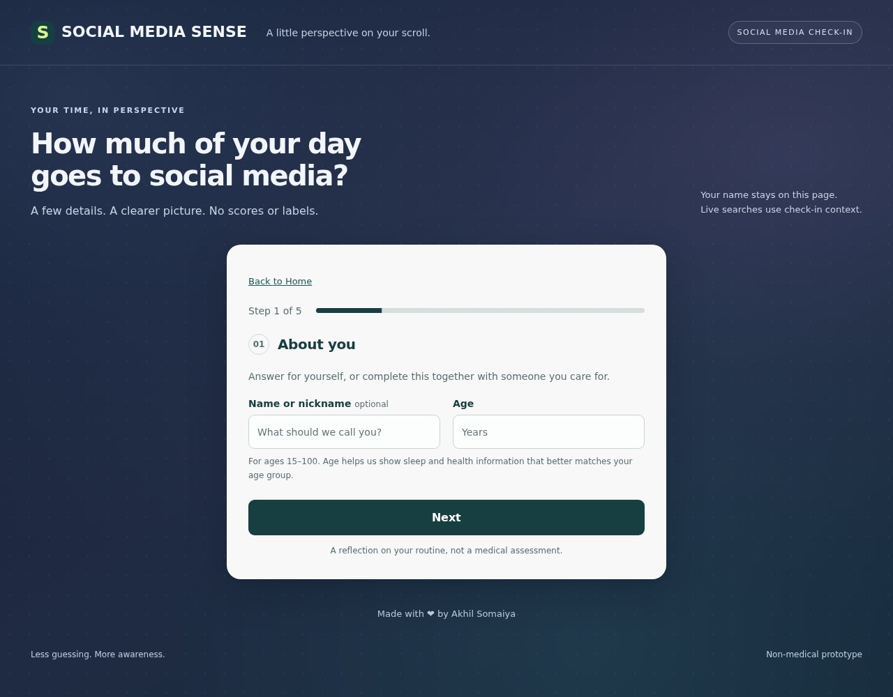
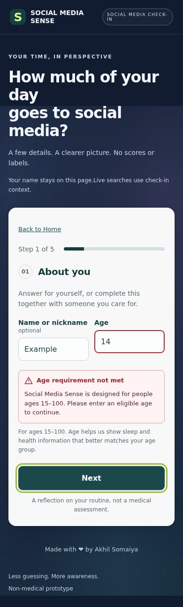
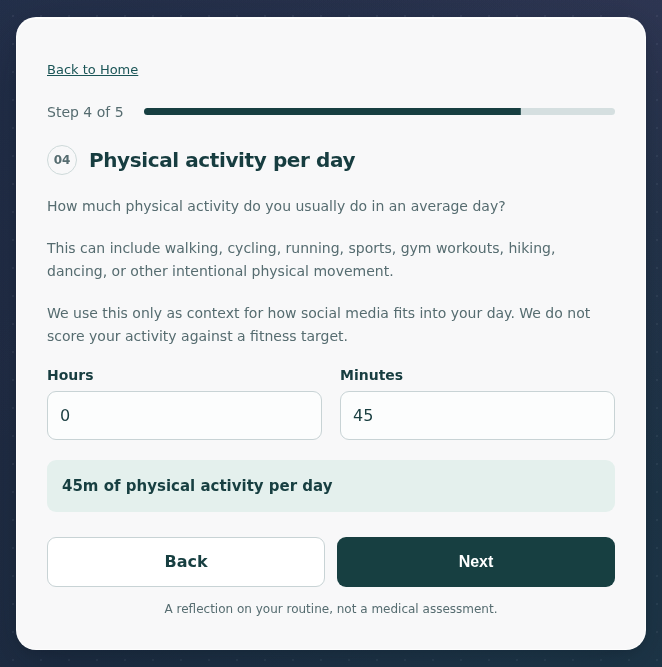
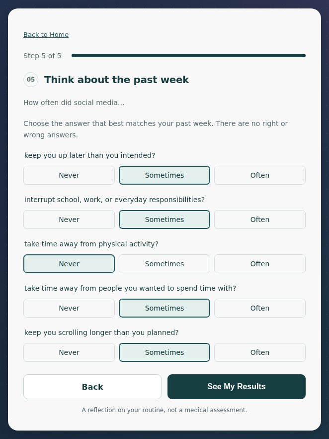
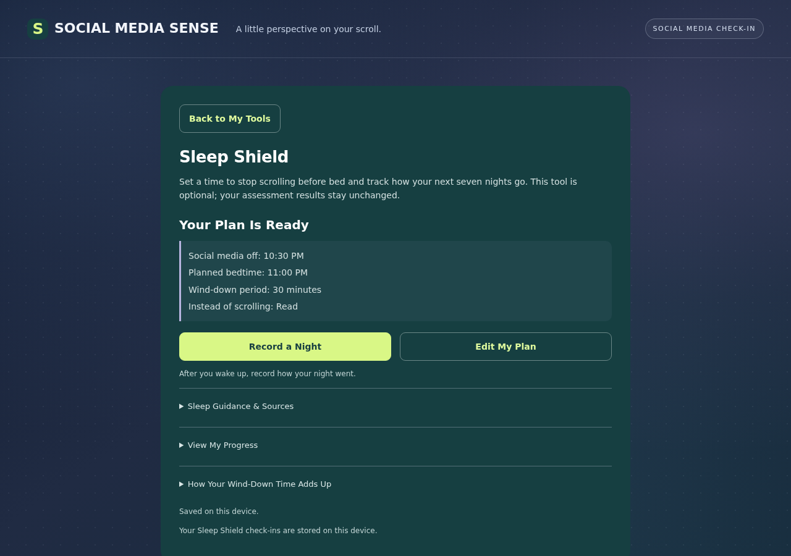

# SOCIAL MEDIA SENSE

**A five-step check-in to understand how social media time fits into everyday life.**

[**Try Social Media Sense**](https://social-media-sense.akhilsomaiya7.workers.dev/) · [**See the walkthrough**](#see-the-project-in-action) · [**Run the project locally**](#run-it-locally)

Social Media Sense is a small, browser-based educational prototype created for a Handshake project. It is designed for people **ages 15–100**. Rather than deciding whether a person's screen time is "good" or "bad," it combines their **estimated social media use** with questions about **sleep, movement, responsibilities, time with others and scrolling longer than intended**.

The result is a personal, **read-only snapshot** of what the person reported, together with an explanation of their routine answers and optional tools for exploring a change. **No account or automatic phone tracking is required.** This is a reflection tool, not a clinical assessment or addiction test.

## Why I built it

An hour of social media can mean something different for different people. Someone may spend time chatting with friends, learning something or working. Another person may notice that scrolling sometimes delays their bedtime or interrupts something they intended to do. **A time total by itself cannot tell those stories apart.**

I built Social Media Sense to make that distinction visible. Instead of diagnosing someone from a number, the project asks about their routine, shows how their answers relate to their estimated use, and leaves decisions about possible changes with the person completing it.

The central question is not **"How many hours are too many?"** It is **"How does my reported social media time fit into the life I want to live?"**

This is an intentionally limited **Handshake portfolio prototype**, not a commercial wellness service. The purpose is to demonstrate a useful idea, build it as a working interactive experience, explain its limitations, and test it carefully—not to keep expanding it with accounts, gamification or complicated tracking.

## What someone can learn

A completed check-in can help someone:

- See their **estimated daily and weekly social media time**, and which platforms make up the largest shares.
- Notice whether they reported any interruptions to **bedtime, responsibilities, movement, relationships or planned stopping points**.
- Understand why a particular routine observation appears as **One Place to Start**, without mistaking it for a diagnosis.
- Explore an **optional next step**, or simply keep the report as a reflection on their current answers.
- Save summary values in their browser and compare a later check-in, without treating a difference as proof of improved health.

For example, a person reporting **90 minutes a day** who sometimes stays up longer than intended can receive a bedtime-oriented next step. Another person reporting **three hours a day**, with **Never** selected for all five routine-interruption questions, is not automatically labelled unhealthy. These are examples of the app's rules, **not research findings, testimonials or statements that any duration is universally safe**.

## The five-step check-in

The assessment is designed for **ages 15–100, inclusive**. A nickname is optional. People can go back to correct their answers, and the completed report does not become an editable goal-setting screen.

| Step | What you enter | Why it matters |
| --- | --- | --- |
| **1. About you** | Optional nickname and age | Selects relevant educational context. Ages outside 15–100 cannot continue. |
| **2. Social media time** | Estimated time for each platform on an average day | Shows a combined total and the platforms contributing to it. |
| **3. Sleep** | Typical nighttime sleep and pre-bed social media frequency | Provides age-relevant sleep context without assuming social media caused a sleep pattern. |
| **4. Physical activity** | Typical daily activity in hours and minutes | Adds routine context, rather than a fitness grade. |
| **5. Everyday routine** | Five **Never / Sometimes / Often** answers about the past week | Determines which reported habits, if any, may be worth reviewing. |

### About the age requirement

Step 1 has an accessible, field-level warning when someone enters an age under 15 or over 100. Under-15 entries receive **"Age requirement not met"** and an explanation of the supported range; invalid entries cannot advance to Step 2.

Age-relevant educational material distinguishes **teens (15–17), young adults (18–29), adults (30–64) and older adults (65–100)**. Teen and young-adult experiences receive specific attention, while adults 30+ remain important. Published medical-source age ranges are preserved as written; they are not rewritten to match the app's eligibility rule.

### About the time sliders

Each built-in platform slider supports **0–12 hours** in **five-minute increments**. Unused platforms can remain at zero. People can add and remove custom platforms. The combined reported total updates live and cannot exceed **24 hours per day**.

When apps are used simultaneously, the person is asked to count the overlapping time only once so the combined total represents their best estimate of time spent. This means the platform-by-platform breakdown is an allocation estimate, **not an exact device measurement**.

The **30-minute marker** describes a research study's combined-use reduction target, and the **two-hour marker** provides context for an optional reduction tool. The markers are **not per-platform limits or universal medical thresholds**. The interface links to explanatory APA and AAP resources.

## Understanding the results

After Step 5, the app displays a short loading transition, followed by **only the completed, read-only report**. The report has three primary sections:

**1. Your Social Media Snapshot.** Estimated daily and weekly totals, plus top platforms. The yearly projection and assumptions are available in expandable details. Calculations use the entered daily average: **weekly = daily × 7** and **yearly = daily × 365**. They do not represent measured historical usage.

**2. Your Personal Insights.** A summary of the person's reported routine, **One Place to Start** when relevant, and general sleep context. A **Sometimes** or **Often** answer flags an observation for reflection. If every routine answer is **Never**, the report acknowledges that no disruption was reported within these questions; it does not certify that the behavior is risk-free. A conditional balance celebration is available for eligible results.

**3. Your Next Steps.** One optional suggestion based on the actual answers, along with ways to save the check-in, explore tools and inspect educational sources. Reported bedtime interference takes priority for **Sleep Shield**. Other disruption may lead to **Reduction Goal** when the usage-based eligibility rule is met; otherwise **Progress** remains an option. The two-hour reference alone is not used to diagnose or label someone.

The completed report cannot be changed by moving a goal slider or tracking a night of sleep. A new assessment creates a new report.

## Three optional tools

These tools can be opened from **My Tools** without first completing the assessment. They are separate from the report.

### Sleep Shield — explore a bedtime routine

Set a planned bedtime, choose a **15-, 30-, 45- or 60-minute** social media wind-down window, and select a replacement activity. The tool displays the planned cutoff and can track **seven nights** of self-reported adherence, sleep and how rested the person felt. Saved plans and night entries remain in the browser. **It does not promise better sleep or prove causation.**

### Reduction Goal — test a hypothetical target

For a current or saved baseline reporting **more than 120 minutes per day**, explore a target reduction and view **before-versus-after time projections** for a day, week, 30-day month and 365-day year. The 120-minute rule is **tool eligibility**, not a health limit. Changing the slider does not mean time has actually been recovered, and saving a goal is a separate action.

### Progress — save and compare check-ins

Explicitly save summary values and compare later entries for estimated usage, platforms, sleep, activity and routine responses. Saved check-ins are **summaries, not historical copies of the entire report or its research**. Clearing saved check-ins also removes their linked reduction goals; Sleep Shield records remain separate.

## See the project in action

These are **real browser screenshots** captured with fictional answers. They are not generated interface mockups or personal user records. They demonstrate the actual assessment, report and optional tools.

The latest validated **15–100 age warning** is shown first. The older homepage capture has been omitted here because it predates the recent homepage-copy update; a new homepage image should only be published after a fresh browser capture is reviewed. Other unchanged screens retain their previously reviewed captures.

### Step 1 — Age eligibility and validation

[](docs/review/age/after-1280.jpg)

[](docs/review/age/underage-390.jpg)

The red warning explains the requirement and keeps the user on Step 1. It is a validation message, not a medical or emergency alert.

### Step 2 — Estimate social media time

[](docs/screenshots/assessment-step-2.png)

[](docs/screenshots/assessment-step-2-sliders.png)

### Steps 3–5 — Your routine

**Step 3: Sleep and pre-bed use**

[](docs/screenshots/assessment-step-3.png)

**Step 4: Physical activity**

[](docs/screenshots/assessment-step-4.png)

**Step 5: Five routine questions**

[](docs/screenshots/assessment-step-5.png)

### The completed report

**Social media snapshot**

[](docs/screenshots/results-report.png)

**Personal insights and one place to start**

[](docs/screenshots/results-insights.png)

**Optional next steps**

[](docs/screenshots/results-next-steps.png)

### Separate tools

**My Tools**

[](docs/screenshots/my-tools.png)

**Sleep Shield**

[](docs/screenshots/sleep-shield.png)

[](docs/screenshots/sleep-shield-tracking.png)

**Reduction Goal**

[](docs/screenshots/reduction-goal.png)

[](docs/screenshots/reduction-savings.png)

**Progress**

[](docs/screenshots/progress.png)

[](docs/screenshots/progress-comparison.png)

The screenshots use a controlled offline research fallback rather than pretending that a live research request succeeded. For reproduction and capture standards, see [screenshot documentation](docs/SCREENSHOTS.md).

## Privacy, evidence and important limits

**Social Media Sense is not a medically validated questionnaire and does not diagnose addiction, anxiety, depression, sleep disorders or other conditions.** It cannot automatically read phone usage, validate that estimates are accurate, or determine that social media caused a reported routine difficulty.

**No account is necessary.** Check-ins, goals and Sleep Shield data that a visitor chooses to save are stored in the **current browser's local storage**. They can be visible to someone else using the same browser profile and may disappear if browser data is cleared. There is no cross-device sync or account backup.

**Live health information is not entirely on-device.** The browser sends limited educational context to `/api/health-information`, which the Worker validates and may pass to the configured external research service:

| Research request | Context passed |
| --- | --- |
| Report education | Broad age group, total daily social media minutes, five routine-disruption frequencies, and relevant topic labels |
| Sleep Shield with a current assessment | The above, plus numeric assessment age and the pre-bed social media response |

These requests do **not** include the person's nickname, platform names or individual app times, reported sleep/activity durations, planned bedtime, journal entries, saved goals or historical records. This is a statement about the application's request fields, not a guarantee regarding infrastructure logs.

Health sources are selected for **educational relevance**, with attention to age applicability, possible benefits as well as risks, and the difference between association and causation. The app shows linked resources where available; live retrieval may fail or have insufficient evidence, in which case it displays previously checked fallback guidance with a notice. Sources do not imply endorsement of the project.

**Unsaved full reports are temporary.** Browser navigation can preserve an in-progress assessment during the current visit, but refreshing can return a person to Step 1, and opening `/results` without an active completed report will not recreate one. Only deliberately saved summary check-ins remain available through Progress.

## How it is built

The frontend uses **HTML, CSS and vanilla JavaScript**. A **Cloudflare Worker** serves the static files, supports readable URLs via the History API and handles the optional research endpoint. The server-side research integration uses the official OpenAI JavaScript SDK. **Node.js, Wrangler and Playwright** support local development, validation, browser tests and screenshot reviews.

The project uses explicit client-side validation, accessible error messages, reduced-motion support, browser route guards, immutable report presentation and local-storage boundaries. These decisions support the scope of a working prototype without adding an account system or a frontend framework.

### Run it locally

Node.js **22+** is required.

```bash
npm ci
npm run build
npm test
npm run dev
```

Open the URL displayed by Wrangler. The basic assessment and fallback education do not require live research credentials. For the optional live research service, configure `OPENAI_BASE_URL` and `OPENAI_API_KEY` **only in the server runtime**; never commit credentials or expose them in frontend code.

### Additional checks and real screenshots

```bash
npx playwright install chromium
npm run test:motion
npm run test:routing
npm run test:age
npm run screenshots
npm run check:cloudflare
```

`npm run screenshots` creates real captures from isolated, synthetic browser sessions under `artifacts/screenshots/`. It deliberately does **not** overwrite the reviewed images shown in this README. Images should be compared with the current UI before publication; do not stretch, fabricate or silently replace them.

The screenshot-review GitHub workflow runs build, unit, motion and routing tests before capturing the gallery. **Recent workflow runs have timed out during a motion-test screenshot**, before the new gallery could be captured. That is an outstanding screenshot-pipeline reliability issue, not proof that new screenshots were successfully produced. Check the next CI run before claiming refreshed screenshot coverage.

For developers, the main files are:

| Area | Files |
| --- | --- |
| Assessment and platform controls | `public/app.js`, `public/flow.js`, `public/platforms.js` |
| Interface and navigation | `public/index.html`, `public/style.css`, `public/navigation.js`, `public/routing.js` |
| Report and educational context | `public/results-report.js`, `public/education.js`, `public/sleep-context.js` |
| Optional tools | `public/goals.js`, `public/sleep-shield.js` |
| Hosting and research | `cloudflare/worker.mjs`, `lib/health.mjs`, `wrangler.jsonc` |
| Tests and reviewed screenshots | `scripts/`, `docs/screenshots/`, `docs/review/` |

The repository retains a Netlify adapter, but **Cloudflare Workers is the current deployment target**.

## Project status

**Social Media Sense is a working, non-commercial Handshake prototype.** Its emphasis is on a clear problem, a useful check-in, honest interpretation of estimates, and well-tested existing functionality—not feature expansion.

I developed and refined the project with AI-assisted coding support and iterative review. The README, tests and screenshot records document what the prototype does and where its limitations remain.

**Made with ❤️ by Akhil Somaiya**
