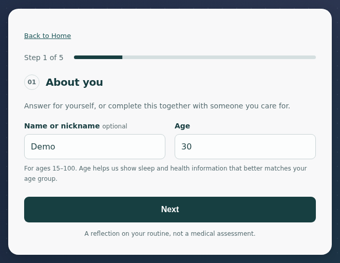
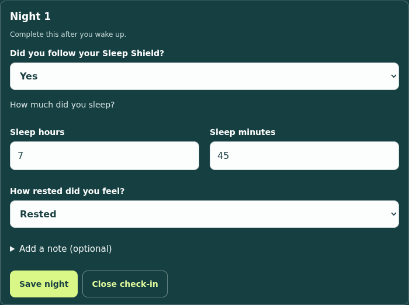
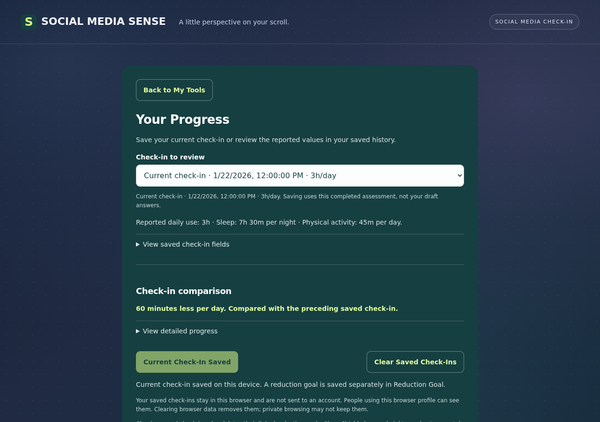

# SOCIAL MEDIA SENSE

**Understand your social media time in the context of your everyday life.**

Social Media Sense is designed for people aged 15–100. Its browser-based, five-step check-in combines the time you estimate spending on each platform with questions about sleep, responsibilities, physical activity, time with other people, and scrolling longer than planned.

Social media time alone does not explain how it fits into someone's life. This project helps you connect the hours you report with the routines you want to protect, then decide whether there is anything you would like to explore or change. It does not measure your phone, grade your habits, or diagnose a condition.

You receive a read-only report with time estimates, explanations drawn from your answers, and optional next steps. Teenagers, adults and older users can complete it for themselves; parents can use it as a starting point for a conversation with a teenager. No account is required.

[Try the live website](https://social-media-sense.akhilsomaiya7.workers.dev/)

## Why I Built Social Media Sense

I wanted to build something that asks what an hour count means in a person's day. Time online can include conversations, learning, work and entertainment. The same amount can fit comfortably into one person's routine while another person reports staying up later or putting off something they meant to do.

That is why I built the check-in around both time and context. Sleep, responsibilities, movement and relationships deserve separate questions. So does the difference between choosing to spend time online and noticing that a short visit became much longer than intended.

My aim is to make those patterns easier to describe without assigning a health score or making the decision for the user. The report records what someone submitted. Optional tools give them room to try a plan or compare later check-ins without rewriting that original account.

I am developing and refining the project with AI-assisted coding support. The implementation and its tests are available here for review; the project is not a clinically validated assessment.

## How the Five-Step Check-In Works

There are no right or wrong answers. The app checks whether entries are complete and within its allowed ranges; it does not reward a particular routine. You can move backward to correct answers during the current visit.

### Step 1 — About You

Enter an optional name or nickname and a required age. The supported age range is 15–100. Age helps the app select relevant sleep context and educational material, because guidance or research about adolescents may not apply to adults or older people. A name is used to address the person in the report, not to create an account.

Educational searches consider broad age groups and self-reported routines: teenagers (15–17), young adults (18–29), adults (30–64), and older adults (65–100). Teenagers and young adults are priority groups for age-relevant evidence, with equally thoughtful coverage for older groups. Age alone does not identify disruption or a medical condition. Ordinary research requests send the broad group, not exact age; existing Sleep Shield research uses the exact assessment age when available. Published sleep-reference populations (such as CDC ages 13–17) remain unchanged. Optional tools still work without an assessment.

### Step 2 — Social Media Time

Estimate an average day's time for each platform using sliders, with custom platforms available under Other. Each slider selects 0–12 hours in five-minute increments; unused apps can stay at zero. The combined total updates immediately and cannot exceed 24 hours.

These are your estimates, not readings automatically retrieved from a device. If two apps are used at the same time, count the overlapping time only once so the total represents time spent rather than the sum of simultaneous app sessions.

The fixed-platform sliders show two reference points: **30 minutes** refers to a study target for reduced combined daily use among college students, and **two hours** is a reference for the optional cutback feature. Neither is an individual-app limit or a universal medically established safe amount. The nearby APA and AAP links provide context. The marked sliders use a nonlinear scale to keep the reference points readable while preserving five-minute selections.

### Step 3 — Sleep

Enter your usual nightly sleep in hours and minutes, then answer how often you use social media in the hour before trying to sleep. The app presents age-related sleep context and sources. It does not diagnose a sleep disorder or infer that social media caused your sleep duration.

Using social media before bed and being kept up later than intended are different answers. The latter is asked separately in Step 5. You do not need to choose a clock-time bedtime to finish the assessment; that belongs to the optional Sleep Shield tool.

### Step 4 — Physical Activity

Estimate your average daily physical activity in hours and minutes. This can include walking, cycling, sports, workouts, dancing and other intentional movement. The app converts the entry into minutes for display and later comparisons; it does not assign a fitness score or diagnose inactivity.

Social media time, sleep and physical activity are separate self-reported estimates. The app does not add them together to decide whether the day is valid.

### Step 5 — Everyday Routine

Think about the past week and choose **Never**, **Sometimes** or **Often** for five questions: whether social media kept you up later, interrupted responsibilities, took time away from physical activity, took time away from people you wanted to see, or kept you scrolling longer than planned.

These answers shape the routine interpretation separately from total time. After selecting See My Results, a short loading transition leads to the completed report. The animation does not make random calculations or change the answers.

## Understanding Your Results

The report has three main sections:

- **Your Social Media Snapshot:** reported daily time, a weekly estimate and the platforms accounting for the most time. Expand the time details to see the yearly estimate and calculation assumptions. Weekly time is daily time × 7; yearly time is daily time × 365. Neither is a measurement of what you actually did over those periods.
- **Your Personal Insights:** an explanation based on the submitted routine answers, **One Place to Start**, and relevant sleep context. “Sometimes” or “Often” flags a habit worth reviewing; a stronger reported disruption takes priority when choosing a starting point. If every routine answer is Never, the report acknowledges that no disruption was reported and includes the conditional balance celebration. It does not certify the amount of use as safe.
- **Your Next Steps:** one optional direction suited to the answers, plus access to Progress, My Tools, and expandable health information and sources. Reported bedtime disruption takes priority for Sleep Shield. Other disruption can suggest Reduction Goal when reported use exceeds 120 minutes. Without that eligibility, or when no disruption is reported, Progress is the practical next action. Time above two hours alone does not trigger a recommendation to cut back.

The report stays **read-only** so a plan cannot be mistaken for a change in the original assessment. Setting a reduction target or recording a Sleep Shield night does not alter the daily total, interpretation or submitted answers. A new completed check-in produces a new current report.

Educational material includes linked sources and publication/update dates when available. Live retrieval uses the check-in context to seek relevant evidence from credible health and research sources. When it fails, existing general educational fallback material remains available with a notice. Source links are there to examine, not to imply that an organization endorses this app.

## What Can Users Learn?

These are hypothetical examples of how the app responds, not research findings, medical advice or testimonials.

**A — A bedtime concern at 90 minutes a day.** Someone reports 90 minutes of use and says it sometimes keeps them up later than intended. The report can suggest exploring Sleep Shield because of that answer, even though daily use is below two hours. The useful question is which bedtime habit they might want to try changing.

**B — Three hours, with no reported disruption.** Someone reports three hours a day and Never to all five routine questions. The app acknowledges that check-in without automatically describing the person as unhealthy or insisting on a reduction. It offers Progress, while optional tools remain accessible. The result describes these answers; it cannot rule out every possible effect of social media.

**C — Exploring a target before committing to it.** Someone with an eligible baseline wants to see what reducing use by 60 minutes per day would mean. Reduction Goal projects 7 hours per week, 30 hours per 30-day month and 365 hours per year—about 15.2 full days. Those figures assume the reduction is maintained. Moving the slider does not mean any time has actually been recovered, and does not automatically save a goal.

**D — Comparing two check-ins.** Someone explicitly saves a check-in, returns later and saves another. Progress can show changes in reported daily time, platform use, sleep and activity, with recorded routine answers available to review. A difference may prompt a conversation about what changed. It is not proof of improved health or that one behavior caused another.

## Explore Your Options With My Tools

My Tools can be opened from the homepage or after a report. The tools are optional: none is required to complete the assessment or guarantees a health outcome.

### Sleep Shield

Choose a planned bedtime, a 15-, 30-, 45- or 60-minute wind-down window, and a replacement activity such as reading or preparing for tomorrow. The tool calculates a scrolling cutoff, including when it falls on the previous day. Save a plan when you want to use it, or resume an existing locally saved plan without another assessment.

After waking, record whether you followed the plan, how long you slept, how rested you felt and any optional notes. The seven-night tracker supports editing entries and reviewing comparisons. Detailed guidance and progress are expandable to keep the main screen short. This can help someone examine a bedtime routine; a protected window is an opportunity, not guaranteed extra sleep, and comparisons do not establish causation.

### Reduction Goal

Choose a current or saved check-in as a baseline. The calculator is available when that baseline reports **more than 120 minutes per day**. This is a tool-eligibility rule, not a medical threshold. A slider explores a reduction up to the reported daily total and displays before/after targets and projected savings over a week, 30-day month and 365-day year.

A draft target stays with its assessment while you visit Progress to save the baseline. Saving a goal is a separate, explicit action; changing the slider does not save it or change reported usage. Starting another assessment does not transfer the old draft to it. The tool is useful for considering an experiment, not for claiming an improvement has already happened.

### Progress

Save a completed check-in explicitly, then compare it with earlier saved records. Progress shows reported time, platform use, sleep, activity and the recorded routine answers. You can revisit saved progress without taking another assessment.

Saved records are **summary data, not full historical reports**. They do not preserve a complete report or its live research. Clearing check-in history requires confirmation and also deletes linked reduction goals; Sleep Shield history remains separate unless you explicitly clear it there.

## Privacy, Evidence and Limitations

No account is required. Estimates may be imprecise, and the app does not automatically measure phone activity, access social accounts or verify behavior. This is an educational reflection tool, not a clinically validated psychological or addiction assessment. It does not diagnose addiction, depression, anxiety, sleep disorders or other medical conditions. Neither the two-hour reference nor any other amount establishes universally safe or unhealthy social media use.

**Saved data stays in this browser.** Check-ins, saved goals and Sleep Shield plans/nights use local storage. Other people using the same browser profile may be able to see them. Clearing browser data may remove them, and private browsing may not retain them. There is no account-based sync or backup.

**Live research is not entirely on-device.** The browser sends a limited context to `/api/health-information`; the server validates it and passes the accepted context to the configured OpenAI research service:

| Request | Context sent |
| --- | --- |
| Report education | Age group, total daily social media minutes, five disruption fields derived from the report, and related topic labels |
| Sleep Shield research with current assessment context | The same context, plus numeric age and the pre-bed social media response |

These application requests do not include the name/nickname, individual platform names or times, reported sleep/activity duration, planned bedtime, journal notes, saved goals or saved history. Opening Sleep Shield without a current assessment uses general fallback guidance rather than inventing an age or assessment. This describes the app's request payloads, not a promise that hosting or service providers keep no operational logs.


Live research can be unavailable or incomplete. Age-specific findings may not apply to another age group, and associations do not establish causes. The app links educational sources and retains fallback guidance; users should consider the scope of the evidence rather than treating a result as a medical conclusion.

**Unsaved answers and full reports are temporary.** Within the current visit, Back/Forward navigation preserves the active draft and the completed report. Refreshing an assessment route starts at Step 1 with an explanation. Opening or refreshing `/results` without a complete report in memory returns home. Saving a check-in in Progress preserves its summary values, not the entire report.

## See SOCIAL MEDIA SENSE in Action

These are real screenshots from the application, using fictional example answers rather than anyone's personal data.

### Start here

<a href="docs/screenshots/homepage.png"></a>

A short check-in to put your social media time in perspective.

### Step 1 — About you

<a href="docs/screenshots/assessment-step-1.png"></a>

Tell the app a little about yourself.

### Step 2 — Social media time

<a href="docs/screenshots/assessment-step-2.png"></a>

Estimate your combined daily time, then set each app’s usage.

<a href="docs/screenshots/assessment-step-2-sliders.png"></a>

A closer look at the app controls. Unused platforms stay at zero.

### Step 3 — Sleep

<a href="docs/screenshots/assessment-step-3.png"></a>

Reflect on your sleep and scrolling before bed.

### Step 4 — Physical activity

<a href="docs/screenshots/assessment-step-4.png"></a>

Add your usual daily activity time.

### Step 5 — Your routine

<a href="docs/screenshots/assessment-step-5.png"></a>

Think about the past week, then see your results.

### Your results

<a href="docs/screenshots/results-report.png"></a>

Start with your reported time and most-used platforms.

<a href="docs/screenshots/results-insights.png"></a>

See which routine answers shaped your personal insights.

<a href="docs/screenshots/results-next-steps.png"></a>

Choose what to explore next. Your report stays unchanged.

### My Tools

<a href="docs/screenshots/my-tools.png"></a>

Choose the tool that fits your needs.

### Sleep Shield

<a href="docs/screenshots/sleep-shield.png"></a>

Make a bedtime plan without changing your assessment.

<a href="docs/screenshots/sleep-shield-tracking.png"></a>

Record a night after you wake up.

### Reduction Goal

<a href="docs/screenshots/reduction-goal.png"></a>

Explore a daily target as an optional experiment.

<a href="docs/screenshots/reduction-savings.png"></a>

See the projected time difference, including the assumptions behind it.

### Your Progress

<a href="docs/screenshots/progress.png"></a>

Save check-ins in your browser and revisit what you reported.

<a href="docs/screenshots/progress-comparison.png"></a>

Compare two check-ins without treating changes as a health score.

Every screenshot comes from a browser-rendered example of the actual app. Research is shown in its offline fallback state rather than a fabricated live search.

## For Developers

The frontend uses plain HTML, CSS and JavaScript, with no routing framework. Cloudflare Workers serves static assets and the server-side health-information endpoint. The History API connects the existing screens to readable paths such as `/check-in/sleep`, `/results` and `/tools/sleep-shield`. The Worker supplies the entry document for supported page routes while keeping API and missing-asset responses separate.

Node.js is used for development and test tooling; Wrangler provides local Worker development and deployment. The official OpenAI JavaScript SDK makes research calls on the server. Playwright runs browser regressions and deterministic screenshot captures. Browser local storage holds intentionally saved data; routing adds no persistent draft store.

### Run locally

Requires Node.js 22 or newer.

```bash
npm ci
npm run build
npm test
npm run dev
```

Open the local URL printed by Wrangler. `build` validates project files and JavaScript; it is not a frontend bundling step. The assessment and tools can be examined without live research credentials, using their educational fallback state.

For live research, the Worker runtime must have server-side `OPENAI_BASE_URL` and `OPENAI_API_KEY` configuration. Keep credentials in secure runtime configuration, never in frontend files or committed source. The Cloudflare handler returns an unavailable response when the required configuration is absent. The repository also retains a Netlify function adapter; the current deployment configuration uses Cloudflare Workers.

### Tests and review captures

```bash
npx playwright install chromium
npm run test:motion
npm run test:routing
npm run screenshots
npm run check:cloudflare
```

- `npm test` covers health-source handling, sleep context, Sleep Shield, slider mapping, custom-platform removal, storage rules and next-step selection.
- `test:motion` checks normal/reduced motion, navigation, focus, loading and report figures at mobile and desktop widths.
- `test:routing` checks browser history, direct links, refresh guards, saved-tool access and the Worker handler using a local asset stand-in.
- `screenshots` captures synthetic browser states into `artifacts/screenshots/`. It does not replace the curated README images. Research is deliberately shown in fallback mode.
- `check:cloudflare` creates a deployment dry-run bundle without publishing it.

The screenshot-review GitHub workflow runs checks and uploads artifacts for review. Updating documentation images is a separate reviewed change. Passing local tests is not a guarantee that every browser or deployed service behaves identically.

### Where to look in the code

| Location | Responsibility |
| --- | --- |
| `public/index.html`, `public/style.css` | Interface markup and visual styling |
| `public/app.js`, `public/platforms.js`, `public/flow.js` | Assessment calculations, sliders, validation and five-step flow |
| `public/navigation.js`, `public/routing.js`, `public/motion.js` | View changes, browser URLs and motion enhancements |
| `public/results-report.js`, `public/education.js`, `public/sleep-context.js` | Report presentation and educational context |
| `public/goals.js`, `public/sleep-shield.js` | Goals, saved progress, bedtime plans and nightly records |
| `cloudflare/worker.mjs`, `lib/health.mjs`, `wrangler.jsonc` | Worker entry point, research handling and hosting configuration |
| `scripts/`, `.github/workflows/` | Validation, automated tests and review captures |

## Project Status

Social Media Sense is an evolving, non-medical prototype. I am refining how clearly it explains estimates, separates submitted answers from optional plans, and helps users choose their own next step. The code, limitations and review history are part of that work, rather than claims of measured health impact.

**Made with ❤️ by Akhil Somaiya**
