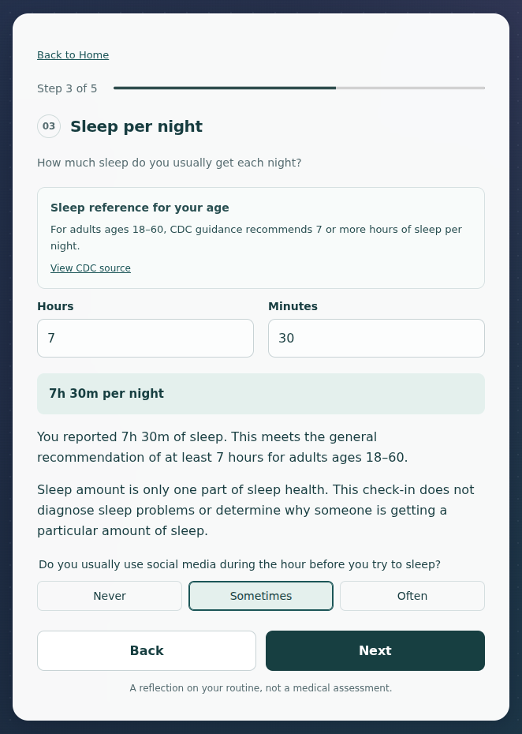
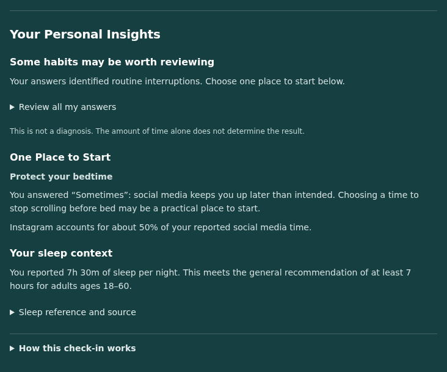
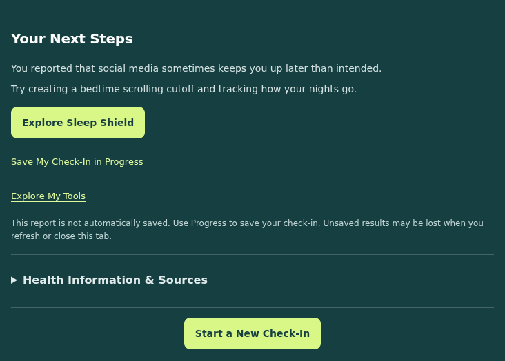

# SOCIAL MEDIA SENSE

**A clearer picture of how social media fits into your day.**

I built Social Media Sense to make it easier to reflect on social media habits without turning screen time into a score or labeling anyone. It starts with a short check-in, then puts your answers into perspective: how much time you reported, what parts of your routine may be affected, and what you might want to explore next.

[Try the live website](https://social-media-sense.akhilsomaiya7.workers.dev/)

## See SOCIAL MEDIA SENSE in Action

These are real screenshots from the application, using fictional example answers rather than anyone's personal data.

### Start here

<a href="docs/screenshots/homepage.png"></a>

A short check-in to put your social media time in perspective.

### Step 1 — About you

<a href="docs/screenshots/assessment-step-1.png"></a>

Tell the app a little about yourself.

### Step 2 — Social media time

<a href="docs/screenshots/assessment-step-2.png"></a>

Estimate your combined daily time, then set each app’s usage.

<a href="docs/screenshots/assessment-step-2-sliders.png"></a>

A closer look at the app controls. Unused platforms stay at zero.

### Step 3 — Sleep

<a href="docs/screenshots/assessment-step-3.png"></a>

Reflect on your sleep and scrolling before bed.

### Step 4 — Physical activity

<a href="docs/screenshots/assessment-step-4.png"></a>

Add your usual daily activity time.

### Step 5 — Your routine

<a href="docs/screenshots/assessment-step-5.png"></a>

Think about the past week, then see your results.

### Your results

<a href="docs/screenshots/results-report.png"></a>

Start with your reported time and most-used platforms.

<a href="docs/screenshots/results-insights.png"></a>

See which routine answers shaped your personal insights.

<a href="docs/screenshots/results-next-steps.png"></a>

Choose what to explore next. Your report stays unchanged.

### My Tools

<a href="docs/screenshots/my-tools.png"></a>

Choose the tool that fits your needs.

### Sleep Shield

<a href="docs/screenshots/sleep-shield.png"></a>

Make a bedtime plan without changing your assessment.

<a href="docs/screenshots/sleep-shield-tracking.png"></a>

Record a night after you wake up.

### Reduction Goal

<a href="docs/screenshots/reduction-goal.png"></a>

Explore a daily target as an optional experiment.

<a href="docs/screenshots/reduction-savings.png"></a>

See the projected time difference, including the assumptions behind it.

### Your Progress

<a href="docs/screenshots/progress.png"></a>

Save check-ins in your browser and revisit what you reported.

<a href="docs/screenshots/progress-comparison.png"></a>

Compare two check-ins without treating changes as a health score.

Every screenshot comes from a browser-rendered example of the actual app. Research is shown in its offline fallback state rather than a fabricated live search.

## Take a five-step check-in

The assessment moves through five short sections:

1. **About you:** enter your age and, if you like, a name or nickname.
2. **Your social media time:** estimate daily time on each platform and see the combined total update.
3. **Sleep:** report your usual nighttime sleep and whether you use social media before bed.
4. **Physical activity:** add your average daily activity time.
5. **Your routine:** reflect on whether scrolling affected bedtime, responsibilities, activity, time with people, or how long you intended to stay online.

After the fifth step, the app shows a **read-only report**. It includes your reported daily, weekly and yearly time, your most-used platforms, and a personal observation drawn from your routine answers. You can read the reasoning and source links without changing the original check-in.

## What you can do afterward

The report is only one part of Social Media Sense. The optional **My Tools** area is separate, so making a plan doesn't rewrite your answers.

**Sleep Shield** helps you choose a scrolling cutoff before bedtime and record how seven nights went. **Reduction Goal** lets you explore a daily time target and projected savings when your reported use exceeds two hours; it doesn't claim you've already changed your habits. **Progress** lets you save check-ins in your browser and compare what you reported over time.

None of these tools is a diagnosis or a requirement.

## Why the app works this way

An hour count doesn't tell the whole story. Someone can spend a lot of time on social media without reporting disruption, while someone with less time might say scrolling keeps them up later than planned. The app therefore asks about routines instead of declaring a universal healthy or unhealthy screen-time limit.

The educational information is age-aware where the evidence supports it, with links to sources. When live research can't be retrieved, the app uses its existing verified fallback guidance rather than inventing new claims.

## Built with

- HTML, CSS, and JavaScript for the interface
- Node.js and Cloudflare Workers for the application and live-research endpoint
- Playwright for browser testing and reproducible example screenshots
- Browser local storage for saved check-ins, optional goals, and Sleep Shield history

I use GitHub to track changes and keep the project improving. The repository includes automated tests for calculations, validation, tool behavior, and several responsive layouts.

### Run it locally

Requires Node.js 22 or newer.

```bash
npm ci
npm run build
npm test
npm run dev
```

Live research requires the Worker environment and its server-side configuration. Keep credentials in environment secrets, never in frontend code or GitHub.

### Privacy

No account is required. Saved check-ins, goals, and Sleep Shield entries stay in the browser's local storage; other people using that browser profile may be able to see them, and clearing browser data may remove them. The app does not send names or saved histories in requests for health information.

## Project notes

I originally focused on a straightforward daily-time check-in and gradually expanded it after testing the assessment and its results. I separated the report from optional tools so users can explore goals or track nights without changing their original answers.

The app is still evolving. I'm continuing to improve the clarity of the results, navigation, and presentation as I test more situations and screen sizes.

**Made with ❤️ by Akhil Somaiya**
