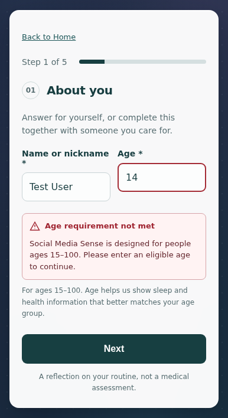
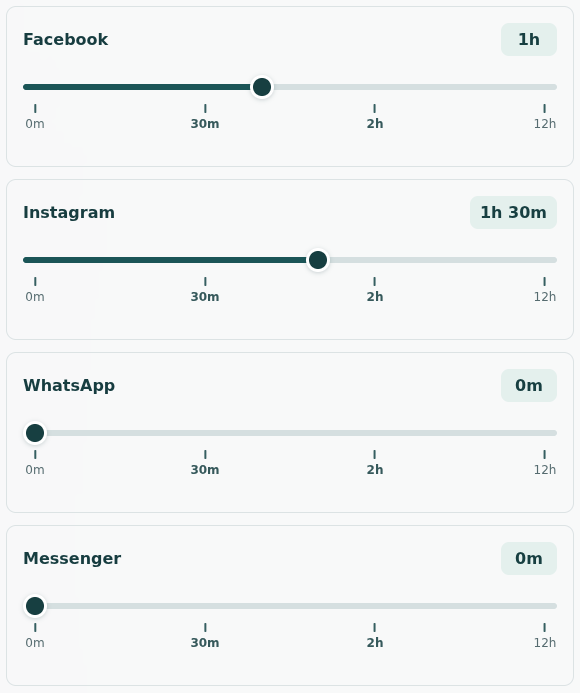
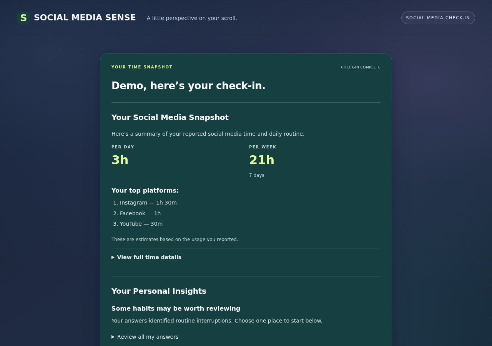
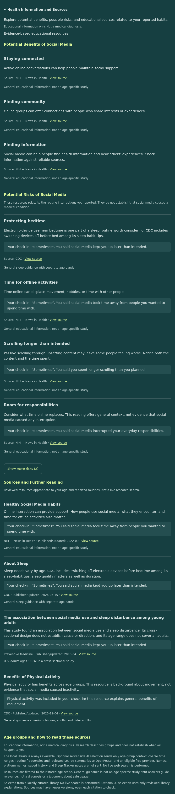
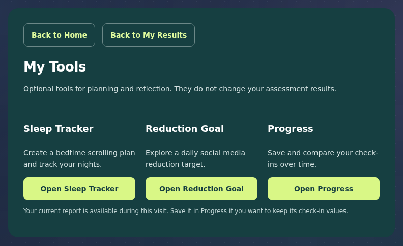
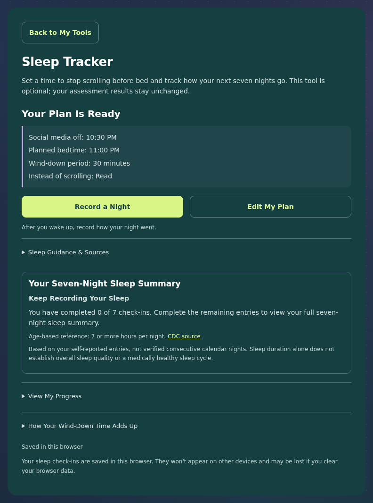
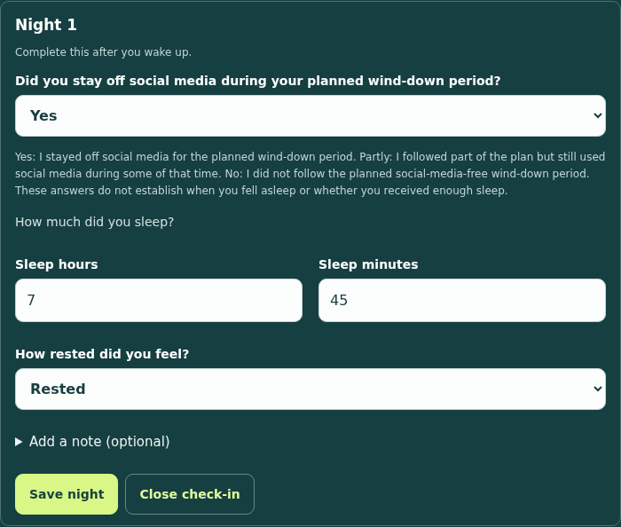
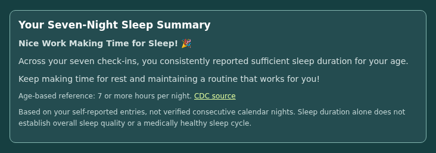
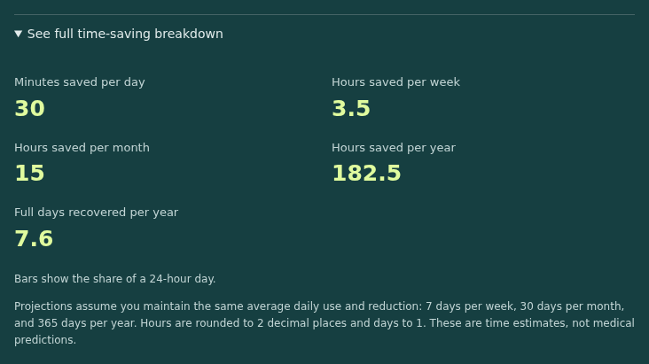
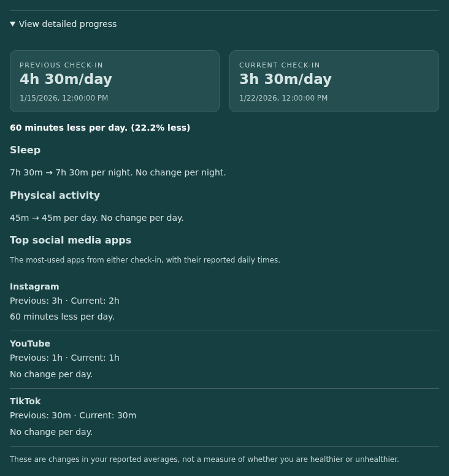

# SOCIAL MEDIA SENSE

**A simple way to look at how social media fits into everyday life.**

[Try the project](https://social-media-sense.akhilsomaiya7.workers.dev/) · [See what it looks like](#see-the-project-in-action) · [Run it locally](#run-it-locally)

<table>
<tr>
<td>
<h3 align="center">NOTE: Educational Purpose &amp; Important Disclaimer</h3>
<p align="left">Social Media Sense is an educational project designed for personal reflection and awareness. This application helps users explore their self-reported social media habits and consider how those habits fit into everyday routines, including sleep and physical activity. The results and suggestions are for educational and informational purposes only. They are not medical diagnoses, clinically validated assessments, or substitutes for professional health advice. The goal is to encourage thoughtful reflection, not to judge, diagnose, or determine whether someone's social media habits are healthy or unhealthy.</p>
</td>
</tr>
</table>

## What I built

I made Social Media Sense as a small project for Handshake. I wanted to create something people could actually try, not just a presentation of an idea.

The question behind it is pretty straightforward: **how does the time I spend on social media fit into the rest of my day?** Just knowing that someone spends two or three hours online doesn't say much about their experience. They might be catching up with friends, learning something new, or finding themselves scrolling when they meant to go to bed.

My project asks people to estimate their social media time and think about a few parts of their routine. After five steps, it gives them a summary of what they entered, points out any interruptions they reported, and offers optional tools if they want to explore a change.

I designed the check-in for **ages 15 to 100**. It doesn't read someone's phone data, give them a health score, or diagnose social media addiction. People can use it without creating an account.

## Why I wanted to make it

I kept coming back to the idea that two people can spend the same amount of time online and have very different experiences. That's why I didn't want to build another calculator that simply multiplies daily screen time by seven.

I wanted people to think about **what that time means to them**. Does it affect bedtime? Are they putting off something they planned to do? Does it get in the way of time with other people? Or does it fit into their routine without any of those issues?

I also wanted the results to feel fair. Someone who reports more time online shouldn't automatically be told they have a problem. Likewise, someone with a smaller total can still have a habit they'd like to work on.

This is a **Handshake portfolio prototype**, not a commercial app or a medical assessment. I'm keeping the scope small and focusing on whether the existing experience is useful, understandable, and reliable.

## What you can do with it

The check-in lets someone see their estimated daily and weekly social media use, find their most-used platforms, and reflect on habits they noticed during the past week. The results explain which answers shaped the summary.

For example, someone who reports **90 minutes a day** but says scrolling sometimes delays their bedtime might see a suggestion to explore a bedtime plan. Someone reporting **three hours a day** with no disruptions across the five questions won't automatically be labelled unhealthy.

These are examples of how I wrote the app's rules, not medical conclusions or research findings.

## How the five steps work

I designed the assessment for **ages 15 to 100**, including both endpoints. A nickname is optional. People can go back to correct their answers, and the completed report does not become an editable goal-setting screen.

| Step | What you enter | Why it matters |
| --- | --- | --- |
| **1. About you** | Optional nickname and age | Selects relevant educational context. Ages outside 15 to 100 cannot continue. |
| **2. Social media time** | Estimated time for each platform on an average day | Shows a combined total and the platforms contributing to it. |
| **3. Sleep** | Typical nighttime sleep and age-related sleep context | Provides age-relevant sleep context without assuming social media caused a sleep pattern. |
| **4. Physical activity** | Typical daily activity in hours and minutes | Adds routine context, rather than a fitness grade. |
| **5. Everyday routine** | Five routine-disruption answers plus a separate pre-bed social media use question | Determines which reported habits, if any, may be worth reviewing. |

### Why I ask for age

Step 1 has an accessible, field-level warning when someone enters an age under 15 or over 100. Under-15 entries receive **"Age requirement not met"** and an explanation of the supported range; invalid entries cannot advance to Step 2.

Age-relevant educational material distinguishes **teens (15 to 17), young adults (18 to 29), adults (30 to 64) and older adults (65 to 100)**. Teen and young-adult experiences receive specific attention, while adults 30+ remain important. Published medical-source age ranges are preserved as written; they are not rewritten to match the app's eligibility rule.

### How the sliders work

Each built-in platform slider supports **0 to 12 hours** in **five-minute increments**. Unused platforms can remain at zero. People can add and remove custom platforms. The combined reported total updates live and cannot exceed **24 hours per day**.

When apps are used simultaneously, the person is asked to count the overlapping time only once so the combined total represents their best estimate of time spent. This means the platform-by-platform breakdown is an allocation estimate, **not an exact device measurement**.

The **30-minute marker** describes a research study's combined-use reduction target, and the **two-hour marker** provides context for an optional reduction tool. The markers are **not per-platform limits or universal medical thresholds**. The interface links to explanatory APA and AAP resources.

## What happens after the check-in

After Step 5, the app displays a short loading transition, followed by **only the completed, read-only report**. The report has three primary sections:

**1. Your Time.** Estimated daily and weekly totals, plus top platforms. The yearly projection and assumptions are available in expandable details. Calculations use the entered daily average: **weekly = daily × 7** and **yearly = daily × 365**. They do not represent measured historical usage.

**2. Your Everyday Balance.** A summary of the person's reported routine, **One optional example** when relevant, and general sleep context. A **Sometimes** or **Often** answer flags an observation for reflection. If every routine answer is **Never**, the report acknowledges that no disruption was reported within these questions; it does not certify that the behavior is risk-free. A conditional balance celebration is available for eligible results.

**3. Make Room for What Matters.** One optional suggestion based on the actual answers, along with ways to save the check-in, explore tools and inspect educational sources. Reported bedtime interference takes priority for **Sleep Tracker**. Other disruption may lead to **Reduction Goal** when the usage-based eligibility rule is met; otherwise **Progress** remains an option. The two-hour reference alone is not used to diagnose or label someone.

I kept the report read-only. Moving a goal slider or tracking a night of sleep doesn't change the original answers. A new assessment creates a new report.

## The optional tools

These tools can be opened from **My Tools** without first completing the assessment. They are separate from the report.

### Sleep Tracker — plan a bedtime wind-down

Set a planned bedtime, choose a **15-, 30-, 45- or 60-minute** social media wind-down window, and select a replacement activity. The tool displays the planned cutoff and lets people record up to **seven self-reported night check-ins**, including whether they followed the wind-down, sleep duration, how rested they felt, and an optional note. Nights can be edited or cleared. A **Seven-Night Sleep Summary** appears when records are available, with encouraging or practical, non-diagnostic feedback based on what was entered. These are seven numbered check-ins, not a verified sequence of seven calendar nights. Saved plans and night entries remain in the browser. **It does not promise better sleep or prove causation.**

### Reduction Goal — explore a hypothetical target

For a current or saved baseline reporting **more than 120 minutes per day**, explore a target reduction and view **before-versus-after time projections** for a day, week, 30-day month and 365-day year. I use the 120-minute rule only to decide when the optional calculator is available. It's not a health limit. Changing the slider does not mean time has actually been recovered, and saving a goal is a separate action.

### Progress — save and compare check-ins

Explicitly save summary values and compare later entries for estimated usage, platforms, sleep, activity and routine responses. Saved check-ins are **summaries, not historical copies of the entire report or its research**. Clearing saved check-ins also removes their linked reduction goals; Sleep Tracker records remain separate.

## See the project in action

These are **real browser screenshots** captured with fictional answers. They are not generated interface mockups or personal user records. They demonstrate the actual assessment, report and optional tools.

These screenshots come from the actual application using synthetic check-ins in an isolated browser. They cover the five assessment steps, report sections and the separate tools, including the seven-night Sleep Tracker summary. Each image keeps its natural proportions. The age-validation examples show the supported **15 to 100** range. See the screenshot manifest for capture details; browser-generated examples are not personal user records.

### Homepage

[](docs/screenshots/homepage.png)

### Step 1: Age and the warning message

[](docs/screenshots/assessment-step-1.png)

[](docs/screenshots/assessment-age-validation-mobile.png)

The red warning explains the requirement and keeps the user on Step 1. It is a validation message, not a medical or emergency alert.

### Step 2: Estimating social media time

[](docs/screenshots/assessment-step-2.png)

[](docs/screenshots/assessment-step-2-sliders.png)

### Steps 3 to 5: Thinking about your routine

**Step 3: Sleep and pre-bed use**

[](docs/screenshots/assessment-step-3.png)

**Step 4: Physical activity**

[](docs/screenshots/assessment-step-4.png)

**Step 5: Five routine questions**

[](docs/screenshots/assessment-step-5.png)

### What the results look like

**Your Time**

[](docs/screenshots/results-report.png)

**Your Everyday Balance**

[](docs/screenshots/results-insights.png)

**Make Room for What Matters**

[](docs/screenshots/results-next-steps.png)

**Health Information and Sources**

[](docs/screenshots/health-education.png)

### My Tools

**My Tools**

[](docs/screenshots/my-tools.png)

**Sleep Tracker — the wind-down plan and seven-night check-ins**

[](docs/screenshots/sleep-tracker.png)

[](docs/screenshots/sleep-tracker-tracking.png)

**Seven-Night Sleep Summary**

[](docs/screenshots/sleep-tracker-seven-night-summary.png)

**Reduction Goal**

[](docs/screenshots/reduction-goal.png)

[](docs/screenshots/reduction-savings.png)

**Progress**

[](docs/screenshots/progress.png)

[](docs/screenshots/progress-comparison.png)

I took these screenshots with fictional data and the regular offline research fallback. They don't represent a successful live search. For reproduction and capture standards, see [screenshot documentation](docs/SCREENSHOTS.md).

## Privacy and a few important limits

**Social Media Sense is not a medically validated questionnaire and does not diagnose addiction, anxiety, depression, sleep disorders or other conditions.** It cannot automatically read phone usage, validate that estimates are accurate, or determine that social media caused a reported routine difficulty.

**No account is necessary.** Check-ins, goals and Sleep Tracker data that a visitor chooses to save are stored in the **current browser's local storage**. They can be visible to someone else using the same browser profile and may disappear if browser data is cleared. There is no cross-device sync or account backup.

**Educational resources come from a reviewed local library.** The report filters CDC, HHS, AAP, NIH and peer-reviewed resources by age and reported routines. Optional server-side OpenRouter free-model selection can arrange those reviewed explanations; it cannot add claims or citations. Limited age-band, rounded-duration and routine context may be sent, without names, platform details or saved records. Local education remains available without a key or AI access. Sleep Tracker retains its existing guidance and fallback behavior. See [optional AI setup and limitations](docs/OPENROUTER.md).

Health sources are selected for **educational relevance**, with age scope, source dates and clickable citations. Both potential benefits and possible risks remain available. The label “Evidence-based educational resources” describes reviewed educational material, not a live search or clinical validation. The library needs periodic manual review; publication dates are not assessment timestamps. Sources do not imply endorsement of the project.

The existing screenshots reflect the previous fallback presentation. The current version selects local resources directly and never attempts the retired paid search endpoint.

**Unsaved full reports are temporary.** Browser navigation can preserve an in-progress assessment during the current visit, but refreshing can return a person to Step 1, and opening `/results` without an active completed report will not recreate one. Only deliberately saved summary check-ins remain available through Progress.

## How I built it

The frontend uses **HTML, CSS and vanilla JavaScript**. A **Cloudflare Worker** serves the static files, supports readable URLs via the History API and provides an optional free-model selection endpoint. Health education renders locally first, without paid OpenAI requests. **Node.js, Wrangler and Playwright** support local development, validation, browser tests and screenshot reviews.

The project uses explicit client-side validation, accessible error messages, reduced-motion support, browser route guards, immutable report presentation and local-storage boundaries. These decisions support the scope of a working prototype without adding an account system or a frontend framework.

### Run it locally

Node.js **22+** is required.

```bash
npm ci
npm run build
npm test
npm run dev
```

Open the URL displayed by Wrangler. Assessment, tools and curated health education work without API credentials. The `/api/health-information` endpoint returns local mode unless an explicit free OpenRouter model and runtime key are configured. No paid model or live web search is used.

### Additional checks and real screenshots

```bash
npx playwright install chromium
npm run test:motion
npm run test:routing
npm run test:age
npm run screenshots
npm run check:cloudflare
node scripts/test-nickname-overflow.mjs
node scripts/test-seven-night-summary.mjs
```

`npm run screenshots` creates real captures from isolated, synthetic browser sessions under `artifacts/screenshots/`. It deliberately does **not** overwrite the reviewed images shown in this README. Images should be compared with the current UI before publication; do not stretch, fabricate or silently replace them.

A [reviewed screenshot workflow](.github/workflows/screenshots.yml) generates isolated synthetic browser captures for inspection. The curated images in this README are updated only after visual review; the workflow does not silently overwrite them. The earlier [screenshot review notes](docs/SHOWCASE-REVIEW.md) and [readiness notes](docs/review/readiness-2026-10-22.md) record prior QA and should be read as dated evidence.

For developers, the main files are:

| Area | Files |
| --- | --- |
| Assessment and platform controls | `public/app.js`, `public/flow.js`, `public/platforms.js` |
| Interface and navigation | `public/index.html`, `public/style.css`, `public/navigation.js`, `public/routing.js` |
| Report and educational context | `public/results-report.js`, `public/education.js`, `public/sleep-context.js` |
| Optional tools | `public/goals.js`, `public/sleep-shield.js` |
| Hosting and educational resources | `cloudflare/worker.mjs`, `lib/health.mjs`, `public/health-fallback.js`, `public/education.js`, `wrangler.jsonc` |
| Tests and reviewed screenshots | `scripts/`, `docs/screenshots/`, `docs/review/` |

The repository retains a Netlify adapter, but **Cloudflare Workers is the current deployment target**.

## Current verification and what's still limited

In October 2026, the core five-step assessment, validation, custom platform removal, results calculations and normal mobile layouts were tested with synthetic answers. A 200-character nickname originally caused horizontal overflow; the fix was verified on the deployed Cloudflare version at **320, 375, 390 and 1366 pixels** after deployment completed. Both ordinary and empty nicknames also passed. The source build and unit tests passed. These are targeted QA results, not a certification of every device or flow.

Isolated saved-history and seven-night Sleep Tracker browser scenarios were not exhaustively covered during that live QA session, because an existing browser profile might contain personal records. Screenshots and tests must use synthetic data and an isolated profile when modifying local storage. See [screenshot policy](docs/SCREENSHOTS.md) for recapture and review instructions.

## Where the project stands

**I built Social Media Sense as a small, non-commercial Handshake prototype.** My focus is on explaining the idea clearly, checking that it works, and being upfront about what it cannot tell someone.

I used AI-assisted coding tools and ChatGPT Work for implementation reviews and browser QA while building this project. I also made decisions about its purpose, questions, layout, and boundaries. I've kept the test notes and screenshots so anyone looking at the repo can see how it works and what I checked.

**Made with ❤️ by Akhil Somaiya**

