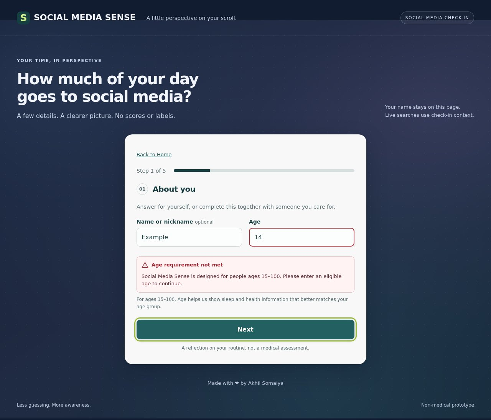

# Reviewing the age requirement

I changed the supported assessment ages to 15 through 100 and checked the warning shown when someone enters an age outside that range. This is a record of that change, including its screenshots and tests.

Based on main `b7f882802d36f32cf1388732b0e9445e63f6379a`. Branch: `codex/age-eligibility-15-100`.

## Implementation

- Assessment ages are 15 to 100 inclusive, enforced by the shared calculation validator, native input attributes, and the browser tool schema. Nickname remains optional.
- Empty, decimal, invalid, under-15 and over-100 entries have distinct messages. Blur and Next show a single field-level alert with a decorative red triangle, textual heading, red input border, and associated accessible description. Valid edits clear it immediately; typing an initial `1` does not create a warning. The warning spans the existing field row so it stays readable at 320px.
- The flow retains its validation/focus architecture. Only age is omitted from the duplicate form-level summary; all other errors retain their existing summary behavior.
- Education groups are Adolescents (15 to 17), Young adults (18 to 29), Adults (30 to 64), Older adults (65 to 100). Source-search instructions prioritize reported routines, balanced coverage and applicable evidence, without assuming student/employment/family status or technological ability. General adult evidence must not be presented as a young-adult-specific finding.
- Ordinary research still sends only the broad group, daily minutes, topics and reported disruption. The existing Sleep Shield research context retains exact age, now validated within 15 to 100. Frontend and backend must be released together for the new Young adults category. The legacy Children broad category remains accepted by the API for compatibility, but new assessments never emit it.
- CDC reference bands remain 13 to 17, 18 to 60, 61 to 64, and 65+, describing source populations rather than product eligibility. Teen nighttime sleep remains incomparable with a total-24-hour reference including naps. Out-of-range assessment ages receive no sleep reference.
- No storage schema, migration, history clearing, optional-tool age gate, report calculations, source verification, source URLs or routing changes. Existing saved tools remain available without a current assessment.

## Browser screenshots

Actual local Chromium pages, synthetic nickname only; no private storage. Before captures are from the unchanged base. Images are compressed JPEGs. The existing README gallery is unchanged.

| State | Mobile | Desktop |
|---|---|---|
| Before | [390px](before-390.jpg) | [1280px](before-1280.jpg) |
| After | [390px](after-390.jpg) | [1280px](after-1280.jpg) |
| Underage warning | [320px](underage-320.jpg), [390px](underage-390.jpg) | [768px](underage-768.jpg), [1280px](underage-1280.jpg) |

## Tests executed

- `npm run build`: pass.
- `npm test`: pass, including the new age suite. All requested age boundaries, exact messages, unchanged totals, sleep-reference bands, four education groups and request privacy checked.
- `npm run test:age`: pass at 320, 390, 768 and 1280px. Tests blur/typing/Next, every requested numeric boundary, blank/decimal/bad input, one persistent alert, accessible attributes, focus, URL/progress blocking and valid progression, preserved nickname/age, no storage writes, no overflow, forced colors and no warning animation. 320px uses reduced motion.
- `npm run test:routing`: pass. Actual Worker handler with filesystem asset binding, then browser coverage at all four widths; report immutability, tools without assessment, saved tools, history, reloads, focus and overflow.
- `npm run test:motion`: pass at all four widths in normal and reduced motion, plus missing optional motion script. Assessment, non-age validation, correct figures, report return, reset and keyboard feedback retained. The age assertion was updated from the old generic summary to the new field alert. An initial concurrent run hit the existing progress-animation timing assertion; the isolated complete rerun passed without changing animation code or relaxing the timing assertion.
- `git diff --check`: pass.
- Visual inspection: warning screenshots at 320, 390, 768 and 1280px. No clipped text or horizontal overflow observed.

Browser commands use the existing Playwright infrastructure. In this environment `PLAYWRIGHT_MODULE` and `CHROMIUM_PATH` select the installed runner/browser. To regenerate age screenshots: `AGE_CAPTURE_DIR=artifacts/age npm run test:age`. Before screenshots require checking out the base revision.

## Limitations

- Live provider retrieval was not exercised with real credentials. Existing controlled success/failure/source-verification tests passed; age-specific evidence availability cannot be guaranteed.
- Native number inputs reject or sanitize some alphabetic characters before JavaScript can read them. The validator rejects invalid text; the browser test uses an incomplete exponent to exercise native `badInput`. A fully sanitized empty field receives the required-age message.
- Accessibility checked via browser focus, semantics, forced colors and reduced motion, not a manual screen-reader session or physical mobile-device test. Browser coverage is Chromium, not a cross-engine certification.
- The previously documented longer-scrolling research reason-text mismatch remains outside this age-only change. No changes to that existing mapping or its fallback behavior.
- No merge or deployment command was executed.

## Changed files

`README.md`, `lib/health.mjs`, `package.json`, `public/app.js`, `public/education.js`, `public/flow.js`, `public/index.html`, `public/sleep-context.js`, `public/style.css`, `scripts/test-age.mjs`, `scripts/test-age-browser.mjs`, `scripts/test-health.mjs`, `scripts/test-motion.mjs`, `scripts/test-sleep-context.mjs`, and this review directory with ten screenshots.
