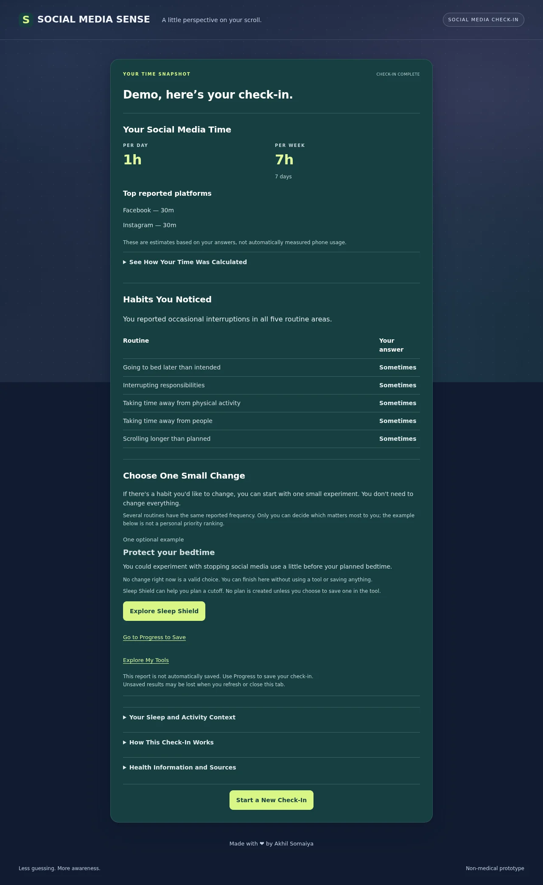
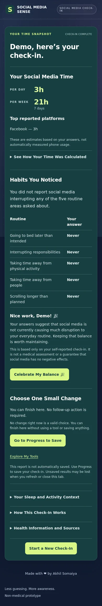

# Option C report review

Base: merged PR #43 on main, `f8a5d779eae0affa79d5797913aa43694c25def9`.

The report now has three main sections: **Your Social Media Time**, **Habits You Noticed**, and **Choose One Small Change**. Its purpose is to help someone consider a habit they personally want to work on. Finishing without changing or saving anything remains a valid choice.

## Changes

The five routine answers are visible in a semantic table, with a short frequency summary above it. They are no longer repeated in a second answer list. Pre-bed frequency, age, sleep and activity values remain available in Your Sleep and Activity Context. Daily/weekly totals and tied platform durations remain visible; yearly projections and formulas retain their existing disclosure.

The shared `selectedRoutine()` function from PR #43 is unchanged. Often precedes Sometimes; ties keep the existing stable ordering. This selects one illustrative experiment, not a personal priority. When several answers share the selected frequency, the report explicitly says only the user can decide which matters most. Each routine has a brief, optional experiment. No experiment is presented as an individualized treatment or promised outcome.

All Never displays no improvement example, including at three hours/day or zero use. Existing celebration eligibility and effects are unchanged. Responsibilities Often plus bedtime Sometimes now shows the focus experiment, consistent with the existing shared selector. An eligible Reduction Goal link is an additional optional tool; the report explicitly says reducing total time is not required for that experiment.

Plans, saved goals and check-in saving remain in their separate tools. Go to Progress to Save is navigation only; saved status updates after an actual save. No storage formats, historical records or goal drafts are changed.

Secondary information is grouped under three disclosures: Your Sleep and Activity Context, How This Check-In Works, and Health Information and Sources. The health disclosure contains ordinary section headings instead of another layer of category disclosures. Existing expandable citation metadata remains. Sources, age applicability, live/fallback notices and all educational claims are retained.

## Files

- `public/index.html`: only the result aside; headings, disclosure grouping and optional-choice text. Existing IDs retained.
- `public/results-report.js`: read-only table from submitted snapshot, experiment copy, user-choice explanation and context display. Reuses the existing selector and navigation paths.
- `public/style.css`: report-scoped table and disclosure styles; no new animations.
- `scripts/test-next-steps.mjs`: experiment copy, ties, no-example and immutable-input assertions, alongside the existing threshold tests.
- `scripts/test-report-clarity.mjs`: updates the report expectations and covers A–H at four widths, saved states, repeated assessments, unavailable storage and real screenshots.
- This directory: browser screenshots and review evidence. No changes to the main README gallery.

## Browser scenarios

| Case | Inputs | Expected presentation |
| --- | --- | --- |
| A | Age 21; Facebook 30m + Instagram 30m; sleep 7h; activity 1h; all Sometimes | Five occasional answers; equal platform durations; explicitly optional bedtime example, no priority claim |
| B | 180m; all Never | No improvement example; eligible celebration; Progress remains available |
| C | Age 16; 30m; bedtime Often | Bedtime example and optional Sleep Shield; nighttime/24-hour caveat retained |
| D | Age 70; 240m; responsibilities Often, bedtime Sometimes | Both frequencies shown; focus experiment; optional reduction link |
| E | 180m; responsibilities and movement Often | Both answers visible; fixed-order example with equal-frequency explanation |
| F | 0m; all Never | Zero totals; no invented problem or forced goal |
| G | Age 15; 45m; all Never | Teenage sleep context; no improvement example |
| H | Age 75; 90m; movement Sometimes | Movement experiment; Progress, no ineligible reduction link |

Each case is exercised at 320, 390, 768 and 1280px. The same browser session completes successive assessments to check that prior answers, examples and saved status do not leak into a new report. The test also navigates to tools and back, checks explicit save/duplicate protection, and simulates a storage write failure before a successful retry.

## Reproduce captures

Run `node scripts/test-report-clarity.mjs` after installing project dependencies and Chromium. Set `CHROMIUM_PATH` only when using an external browser executable. The script uses the actual local Worker harness with synthetic Demo data and a controlled research-unavailable response.

For before screenshots, place this base revision's `public/` files under `artifacts/option-c/baseline/public/`, then run `REPORT_BEFORE=1 node scripts/test-report-clarity.mjs`. These are genuine base-revision renders, not reconstructed mockups. Full-page WebP copies retain the original aspect ratio.

## Review limits

Browser checks use Chromium, not physical devices, Safari, Firefox or a real screen reader. Automated checks verify labels, row/column headers, keyboard disclosures, focus, reduced motion, and overflow; they are not an accessibility certification or a first-time user study.

The normal Playwright browser download failed locally. A temporary external Chromium 153 installation was used without changing project dependencies. A test-machine Noto Emoji font supplies glyphs; emoji may appear monochrome. Research success/failure tests use controlled fixtures. Captures intentionally show fallback education, not a successful live health search.

The user-facing choice and clarity still need human review. In particular, a fixed example may still draw attention even when the report explains that it is not a personal priority. The report deliberately does not add a habit picker or goal editor.

## Executed validation

| Command / check | Result |
| --- | --- |
| `npm ci` | Passed |
| `npm run build` | Passed |
| `npm test` | Passed, including new optional-experiment assertions and unchanged calculation/storage tests |
| `npm run test:motion` | Passed, normal and reduced motion at all four widths; 2.8s/200ms loading paths, single completion, preserved answers, focus, forced colors |
| `npm run test:routing` | Passed, Worker route handling and browser navigation at all four widths |
| `npm run test:age` | Passed at all four widths |
| `npm run screenshots` | Passed; 25 deterministic local captures; existing gallery not replaced |
| `npm run check:cloudflare` | Passed dry run; no deployment |
| `node scripts/test-results-layout.mjs` | Passed, including goals, seven-night tracking, saved history, reload, research success/fallback fixtures and celebration |
| `REPORT_BEFORE=1 node scripts/test-report-clarity.mjs` | Passed; before screenshots captured from unchanged main |
| Scope and ID checks | HTML outside report unchanged; all existing IDs retained, no duplicates |
| `git diff --check` | Passed |

No runtime dependencies, deployment settings or GitHub workflow changes. The standard browser download failure was an environment setup issue; actual browser tests ran with the external Chromium installation described above. No browser-test assertion or timeout was weakened.

Final `node scripts/test-report-clarity.mjs`: **32/32 cases passed** (A–H × four widths), including correct daily/weekly/yearly totals, table semantics, exactly five answer rows, optional examples, all Never, age context, disclosures, source link styling/citations, no auto-saving, failed storage writes, duplicate-save prevention, unchanged report/tool return, repeated assessments and no overflow/page errors.

## Real before-and-after screenshots

Full-page captures preserve natural aspect ratios. These use fictional data, not production browser history. The expanded example shows calculation details, sleep/activity context and fallback health information; the default examples keep those details closed.

| View | Desktop (1280px) | Mobile (390px) |
| --- | --- | --- |
| Previous report: all Sometimes | [Before](before-A-1280.webp) | [Before](before-A-390.webp) |
| New report: all Sometimes, equal platforms | [After](after-A-1280.webp) | [After](after-A-390.webp) |
| New report: all Never | [After](after-B-1280.webp) | [After](after-B-390.webp) |
| New report: bedtime Often | [After](after-C-1280.webp) | [After](after-C-390.webp) |
| Previous report: mixed frequencies | [Before](before-D-1280.webp) | [Before](before-D-390.webp) |
| New report: mixed frequencies | [After](after-D-1280.webp) | [After](after-D-390.webp) |
| Previous report: details expanded | [Before](before-expanded-1280.webp) | [Before](before-expanded-390.webp) |
| New report: details expanded | [After](after-expanded-1280.webp) | [After](after-expanded-390.webp) |

