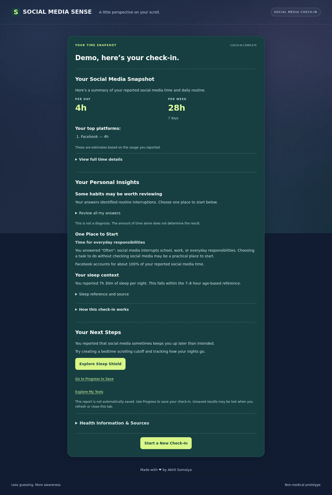
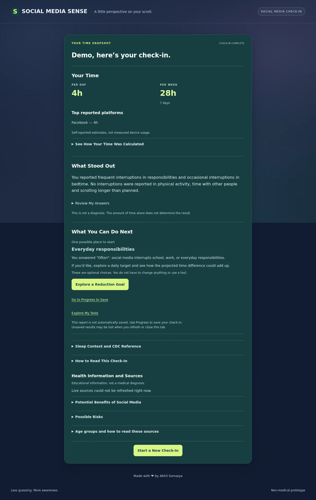

# Results report clarity review

Base: main `2789df569e76e381ce93005b2ee5987d5c068798`.

## What changed

The report now answers three questions in order: Your Time, What Stood Out, and What You Can Do Next. Daily/weekly estimates and top platforms stay visible. Yearly totals, the 24-hour percentage and formulas stay in See How Your Time Was Calculated. A plain list replaces ordinal platform numbering; equal reported durations do not imply different harm.

The main observation summarizes the five submitted routine answers using occasional for Sometimes and frequent for Often. It states which areas had no reported interruptions. All Never remains a useful outcome at any valid usage total. Review My Answers retains the individual responses and pre-bed context.

There is one optional starting point, followed by a route to explicit saving in Progress and a smaller My Tools link. Sleep Shield, Reduction Goal and Progress stay separate. Returning from a tool does not create a new assessment or research request. The report explicitly permits taking no further action.

Sleep context, methodology, benefits, risks and sources are secondary disclosures. The unnecessary outer health disclosure and nested sleep-reference disclosure were removed. Benefits and risks remain available, collapsed, even for a balanced check-in. The existing shorter balanced reading list remains. Live/fallback notices and source applicability are retained.

## One selection rule

`selectedRoutine()` in goals.js is shared by `biggestOpportunity()` and `nextStepRecommendation()`.

1. Choose an answer marked Often before any answer marked Sometimes.
2. Break ties in this fixed order: bedtime, longer scrolling, responsibilities, physical activity, time with other people.
3. No reported interruption means no behavioral starting point is selected.
4. Selected bedtime → optional Sleep Shield. Other selected area with daily use >120 minutes → optional Reduction Goal. Otherwise → Progress.

The order is a display rule, not a clinical ranking. Time and pre-bed use cannot create or override an interruption. For example, responsibilities Often now takes priority over bedtime Sometimes throughout the report. The existing >120-minute calculator eligibility remains a product rule.

Previously saved records retain their recorded starting point. New check-ins store the selected observation using the same existing fields; there is no storage migration or change to historical records. Platform-share calculations are retained but their extra note is not repeated in the report.

## Files

- `public/index.html`: report hierarchy and native disclosures; existing IDs retained.
- `public/style.css`: report-only spacing and hierarchy, plain platform list, forced-colors support.
- `public/results-report.js`: answer summaries, shared recommendation selection and read-only presentation.
- `public/goals.js`: shared routine selection; no goal formula or storage changes.
- `public/education.js`: keeps benefits/risks available inside collapsed sections for all outcomes; retrieval and sources unchanged.
- `public/balance.js`: removes the obsolete “guidance above” direction in neutral copy; celebration eligibility/effect unchanged.
- `scripts/test-next-steps.mjs`, `scripts/test-health.mjs`: tests for the intentional selection/presentation changes.
- `scripts/test-report-clarity.mjs`: A–F scenario, saving/navigation, age context, repeated-assessment and responsive regressions.
- This directory: reviewed browser captures and test evidence. The README gallery is not overwritten.

## Reproduce

Run the existing build/tests, then `node scripts/test-report-clarity.mjs`. Set `CHROMIUM_PATH` only when using a separately installed Chromium. The browser test creates isolated fictional Demo profiles and explicitly mocks research failure. It writes actual PNG captures at 390/1280px while exercising all six scenarios at 320/390/768/1280px.

For comparison captures, put the base revision's `public/` tree in `artifacts/clarity/baseline/public/`, then run `REPORT_BEFORE=1 node scripts/test-report-clarity.mjs`. This captures the real base implementation for cases A/D, not a reconstructed mockup. Published WebP copies preserve original dimensions and use quality-90 compression.

## Accessibility and limits

Native details/summary remain keyboard operable, with visible focus. Original result-heading focus, loading behavior, motion preferences and navigation are preserved. No input or goal-setting controls were added to the report. Sources remain clickable and distinguish fallback from successful retrieval.

These are automated checks and developer screenshot reviews, not first-time participant feedback or assistive-technology certification. The captured research failure is a controlled fixture, not a live retrieval result. Standard Playwright browser download failed locally; local browser checks use Chromium 153 extracted from a temporary external test installation, with no project dependency change. No claims of Safari, Firefox or physical-device testing.

## Tests executed

| Command / check | Result |
| --- | --- |
| `npm run build` | Passed |
| `npm test` | Passed, including shared selection and summary tests |
| `npm run test:motion` | Passed at 320/390/768/1280px, normal and reduced motion |
| `npm run test:routing` | Passed at all four widths against the Worker harness |
| `npm run test:age` | Passed at all four widths |
| `npm run screenshots` | Passed; 25 deterministic captures, existing gallery not replaced |
| `npm run check:cloudflare` | Passed dry run only; no deployment |
| `node scripts/test-report-clarity.mjs` | Passed all 24 A–F × width cases |
| `node scripts/test-results-layout.mjs` | Passed isolated rerun, including tool/storage/tracking and research mock success/fallback |
| HTML scope and IDs | Outside-report HTML unchanged; existing IDs retained, no duplicate IDs |
| `git diff --check` | Passed |

The additional tools test initially timed out twice near clearing check-in history / resuming nightly tracking (different wait points). Unmodified main passed, and the unchanged candidate then passed an isolated rerun. No assertion or timeout was weakened. The intermittent timeout's root cause remains unconfirmed; the final pass does not establish that the test is free of flakiness.

Screenshots use synthetic data and a controlled research-unavailable response. No production API, credential, or live evidence validation is claimed. A test-machine-only Noto Emoji font resolves missing glyphs in final captures; emoji may appear monochrome in this headless browser. No font dependency or font change was added to the application.

## Actual browser screenshots

These are full-page captures, not mockups. Click a link for the full-size image. The image manifest records dimensions, sizes and hashes. All layouts were checked for horizontal overflow at 320, 390, 768 and 1280px.

| Case | Desktop (1280px) | Mobile (390px) |
| --- | --- | --- |
| A — 1h, all Sometimes, before | [Before](before-A-1280.webp) | [Before](before-A-390.webp) |
| A — 1h, all Sometimes, after | [After](after-A-1280.webp) | [After](after-A-390.webp) |
| B — 3h, all Never | [Report](after-B-1280.webp) | [Report](after-B-390.webp) |
| C — 30m, bedtime Often, age 16 | [Report](after-C-1280.webp) | [Report](after-C-390.webp) |
| D — 4h, responsibilities Often / bedtime Sometimes, before | [Before](before-D-1280.webp) | [Before](before-D-390.webp) |
| D — same answers, after | [After](after-D-1280.webp) | [After](after-D-390.webp) |
| E — equal 30m platform entries | [Report](after-E-1280.webp) | [Report](after-E-390.webp) |
| F — 5m, all Never | [Report](after-F-1280.webp) | [Report](after-F-390.webp) |

### Before and after: mixed frequencies

